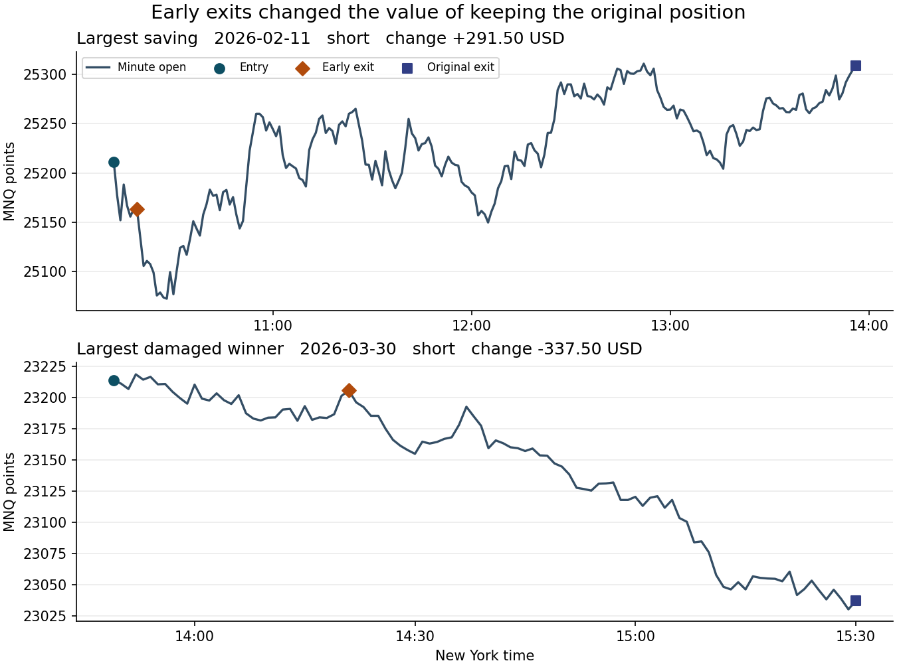

# Where the apparent value of a confirmed reversal went

The original reservoir had already exited by the first executable response to every confirmed flip on the frozen sample. On the 60 previously examined external sessions, 111 next-open reversals lost an average of 9.71 points between the early exit and the first fill that could act on confirmation. The 157 surviving signals gained 5.02 points over that leg and another 0.49 points to the original exit. Of the 15.22-point difference between groups, 14.73 points had already elapsed by the response fill. The realized flip is a retrospective label. Only its estimated probability was known at issuance.

The predeclared continuation neuron took the original side's average matured residual on surviving trades, discounted it by the probability of survival, and assumed zero expected move through confirmation. The probability factor was positive at all 900 decisions, so it changed forecast magnitude and never changed the sign of the exit instruction. Mean squared forecast error exceeded a constant zero-point forecast in all four comparisons.

| Source and fill | Actual flips | Survival neuron, net change | Net at $6 | Marked drawdown at $6 | Upper intrabar drawdown at $6 |
|---|---:|---:|---:|---:|---:|
| Discovery, next open | 64 | +$901.50 | +$1,354 | $1,931.50 | $1,960.50 |
| Discovery, extra minute | 52 | +$747.50 | +$424 | $2,570 | $2,612.50 |
| External, next open | 111 | +$335.50 | −$3,485.50 | $4,965 | $5,014 |
| External, extra minute | 97 | −$187 | −$2,921.50 | $4,765 | $4,828.50 |

Fixed entries preserve the same original trades within each row. Removing the three largest improvements made the net change negative in every row. External stressed nets were −$5,108.50 and −$4,448.50. Every marked drawdown exceeded the historical $1,500 research budget. These losses and the paired forecast comparisons fail the frozen economic criteria. The probability that a signal will change retains its separate warning-only interpretation.



The [frozen protocol](protocol.md), [individual predictions and return components](results/decisions.csv.gz), [paired errors](results/summary.json) and [costs, dollar attribution and observed risk](results/risk.json) reproduce the comparison. Earlier steps examined the [first eligible decision](https://github.com/alex0204360/NQ-profitability-research/tree/research/reversal-conditioned-hold-value/experiments/branch_value) and the [first reachable warning](../reachable_value).

```sh
python -m experiments.confirmation_value.run experiments /tmp/mnq-confirmation
cmp /tmp/mnq-confirmation/summary.json experiments/confirmation_value/results/summary.json
cmp /tmp/mnq-confirmation/decisions.csv.gz experiments/confirmation_value/results/decisions.csv.gz
python -m experiments.confirmation_value.risk experiments /tmp/mnq-confirmation/risk.json
cmp /tmp/mnq-confirmation/risk.json experiments/confirmation_value/results/risk.json
python -m experiments.confirmation_value.chart experiments /tmp/mnq-confirmation/extreme-exits.png
```
