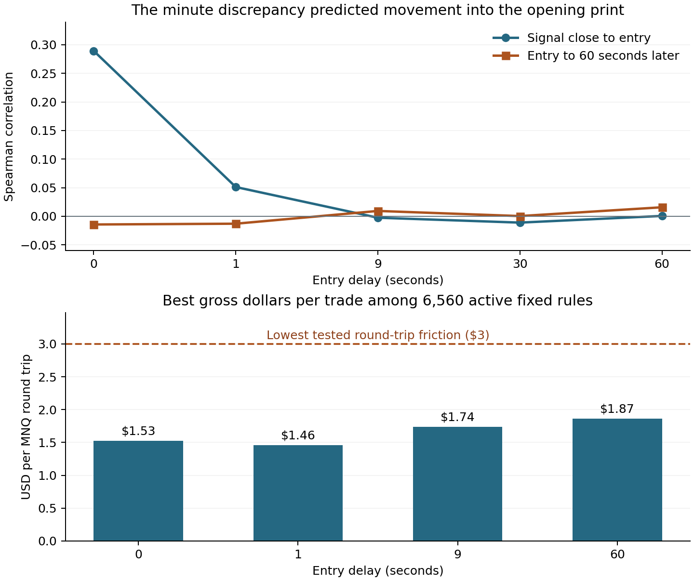

# An exact economic limit on the observed two-contract event categories

Every one of the 6,560 fixed rules that traded lost money at $3, $6 and $9 friction, at each of the four tested delays. The remaining rule held cash. This rules out a profitable reassignment of these eight categories on these printed-price replays. It does not answer what a different holding period, a continuous feature or a richer source could achieve.

A category identifies the contract that moved first, the sign of its move, and whether the gap closed through catch-up or withdrawal. Each rule independently chooses follow, fade or abstain in each category. The replay respects each rule's individual position occupancy, so the comparison includes the opportunities that become available after an abstention. The chronological learner committed to one table before each session using only earlier days. It chose cash throughout.

| Additional entry delay | Highest gross per trade of any active rule | Best active rule net at $3 | Best active rule net at $6 |
|---|---:|---:|---:|
| 0 seconds | $1.53 | −$1,766.00 | −$3,915.00 |
| 1 second | $1.46 | −$1,862.50 | −$4,034.00 |
| 9 seconds | $1.74 | −$1,088.50 | −$3,176.50 |
| 60 seconds | $1.87 | −$1,059.00 | −$3,191.00 |

Each column maximizes its own statistic across all rules in hindsight. The high-water marks therefore give these categories more latitude than a trader choosing a rule ahead of time. At $6 the best worst-case net over both one and nine seconds was −$4,034 among active tables. All 6,560 noncash tables traded at every delay. There were no unresolved exits in the counterfactual opportunity archive.



### Research handoff

The minute discrepancy contained information about the movement into the next opening print. Across the common 4,978-observation one-second audit it had negligible rank against the subsequent executable-window movement at one or nine seconds. An independent source check confirmed 5,209 exact joint minute aggregates over 23 dates. Neither fine source recorded the April 8 outlier at 10:08 NY. The archive supplies printed-second OHLCV and no quotes or receipt times.

The path neuron distinguishes a lagger catching up from a leader withdrawing, and its attribution exactly partitions observed gap closure. Across 13,247 resolved episodes the frozen strong-event policy emitted 10,903 directional signals. Its one-second execution ledger completed 3,085 trades and lost $211 gross. The exact policy-class study then checked whether a different assignment of actions could pay friction. Retire this eight-cell representation for the one-minute holding objective. These are exploratory economic and data-quality results. No model in this pass qualified for live execution or independent economic validation.

For an independent study of a subsecond edge, the missing observation is the **first executable MNQ bid or ask after both venues' updates were actually received**, together with the contract identity, ordered event and receipt times and a corresponding executable exit quote. For the current holding-duration research, the earlier frozen occupancy-only registration remains separate. Avoid repeating categorical threshold or sign searches on these same outcomes.

[Prespecified enumeration](protocol.md) · [All table results](results/tables.csv.gz) · [Chronological choices](results/chronological.csv) · [Second-bar audit](https://github.com/alex0204360/NQ-profitability-research/tree/research/mnq-nq-intraminute-audit/experiments/intraminute) · [Transfer-neuron replay](https://github.com/alex0204360/NQ-profitability-research/tree/research/mnq-nq-transmitted-move/experiments/transmitted_move)

```sh
python -m experiments.policy_bound.run experiments/transmitted_move/results rerun
python -m experiments.policy_bound.figure
```
